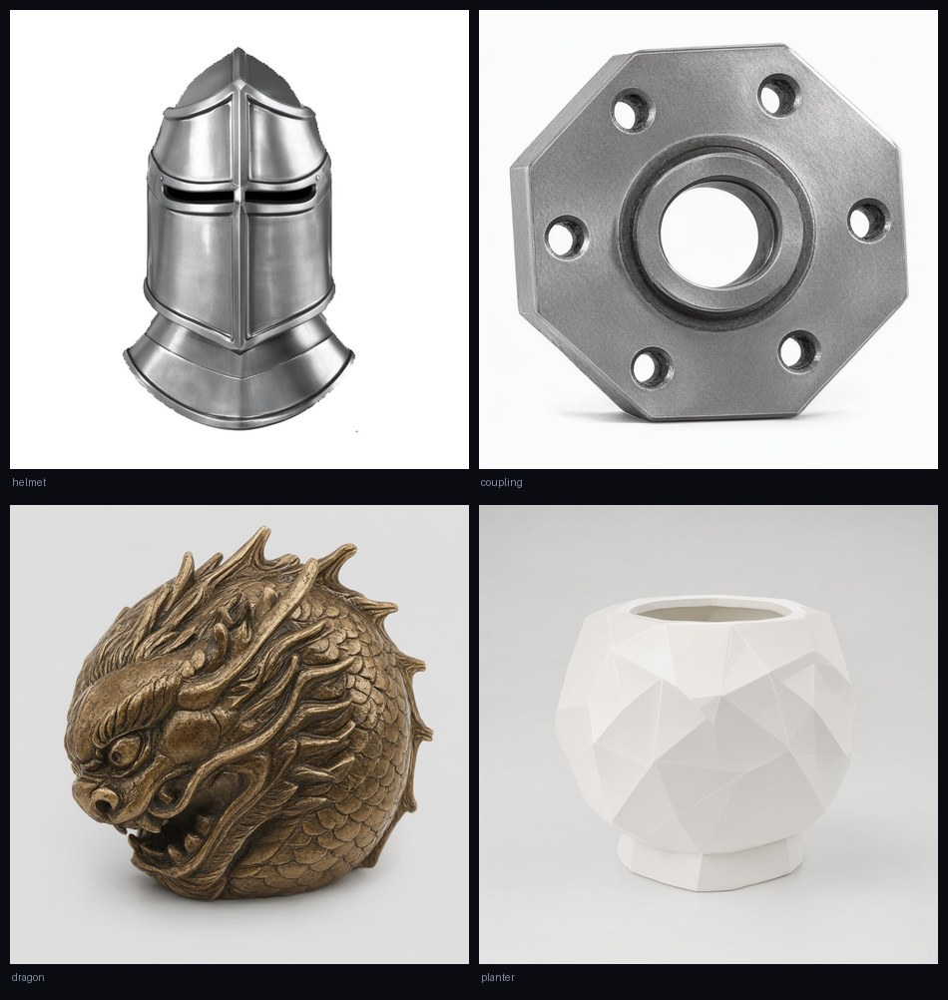

# ForgeForm 铸想

One sentence in, one printable STL out.

Runs the whole chain locally: LLM parses the request → generate an image → image-to-3D → seal the mesh → export a millimetre-scale STL. No cloud API.



## What it does

| Stage | Does | Backend |
|---|---|---|
| Chat | Parses the request, fills in parameters, handles revisions | Local LLM (OpenAI-compatible endpoint / Ollama) |
| Image | Text-to-image, 1–4 candidates, reference-image i2i, inpaint | ComfyUI or diffusers |
| 3D | Single image to mesh | ComfyUI (Hunyuan3D 2.1) or hy3dgen |
| Export | GLB → STL: decimate, fill holes, watertight, mm scale, snap to bed | trimesh / pymeshlab / pymeshfix |
| Print | Discover Bambu printers on the LAN and send jobs | bambu-cli (optional) |
| Manage | Conversation groups, project archive, model library, VRAM/temp monitor | built in |

Reverse paths also work: upload a video to extract a frame, or upload a GLB to convert directly to STL.

## Measured (Tesla V100 32G, single card)

| Step | Time |
|---|---|
| Image 1024², Qwen-Image-2.1, 20 steps | ≈ 56 s |
| Image 1024², 30 steps (incl. zh→en translation) | ≈ 140–170 s |
| 3D Hunyuan3D 2.1, 256 octree | ≈ 160 s |
| 3D Hunyuan3D 2.1, 512 octree | ≈ 8–10 min |
| 3D Hunyuan3D 2mini (direct), 256 octree | 42 s load + 13 s inference |
| STL export (200k → 80k faces) | ≈ 3–6 s |

Four end-to-end runs with per-object timings, face counts, watertightness and four-view STL renders:
`docs/showcase/`

## Quick start

```powershell
git clone https://github.com/TIANKONGskyy/forgeform.git
cd forgeform
pip install -r requirements.txt

python tools/setup.py     # probes hardware and installed frameworks, recommends, installs
python app.py             # → http://127.0.0.1:7860
```

`tools/setup.py` detects VRAM, RAM, disk, and any existing ComfyUI / Ollama / llama.cpp / vLLM /
local diffusers models, then offers profiles:

```
Hardware: Tesla V100 32G (30 free) · 128 GB RAM · 166 GB disk
Found:    ComfyUI(+3D), 2 local diffusers models, hy3dgen, chat service

 ★ [1] Reuse existing ComfyUI (0 download)      0.0 GB · auto
   [2] Minimal (SD1.5 + 3D 2mini)               8.2 GB · direct
   [3] Recommended (Z-Image + 3D 2mini)        30.6 GB · auto
```

Also supports `--dry-run` (show only), `--custom` (pick models yourself), `--profile <name> --yes`.

Then check the environment:

```powershell
python tools/doctor.py
```

## Requirements

- Windows 10/11
- NVIDIA GPU, 8 GB VRAM minimum, 16 GB+ for the full chain
- 32 GB RAM recommended (direct 3D holds ~10.8 GB)
- Python 3.11+
- A local LLM endpoint (optional; falls back to rule-based mode)

Per-VRAM capabilities and measured memory use: `docs/HARDWARE.md`

## Models

Models are located by **filename** under the ComfyUI directory, or by `path` pointing at a local
diffusers directory. Which file, where it goes, how big: `docs/MODELS.md`.

Swapping a model means editing one YAML under `plugins/image/*.yaml`, not code: `docs/PLUGINS.md`.

## Backends

Three modes via `config.json → backend.mode`:

| mode | Behaviour |
|---|---|
| `comfyui` | ComfyUI only (default) |
| `direct` | diffusers / hy3dgen only, no ComfyUI |
| `auto` | Probe the machine at startup, route each stage |

Details and measurements: `docs/BACKENDS.md`

## Docs

| File | Contents |
|---|---|
| `docs/HARDWARE.md` | Measured VRAM/RAM use, per-tier recommendations |
| `docs/MODELS.md` | Download URLs, destinations, sizes |
| `docs/CONFIG.md` | Configuration reference and per-VRAM profiles |
| `docs/PLUGINS.md` | Model plugins (YAML) |
| `docs/BACKENDS.md` | Three backends with measurements |
| `docs/ARCHITECTURE.md` | Module responsibilities and core mechanisms |
| `docs/DECISIONS.md` | D1–D10 design decisions |
| `skills/forgeform/SKILL.md` | Agent skill file |
| `CONTRIBUTING.md` / `SECURITY.md` | Contribution rules / security notes |

## Tests

```powershell
python -m pytest          # 207 cases, no GPU required
python tools/verify.py    # 151 structural assertions
```

## License

AGPL-3.0. The watertight repair step links `pymeshselab` (GPL-3.0) and `pymeshfix` (AGPL-3.0),
which are copyleft. Models and prints you produce are yours; AGPL governs the software.

Third-party components: [NOTICE](NOTICE)
