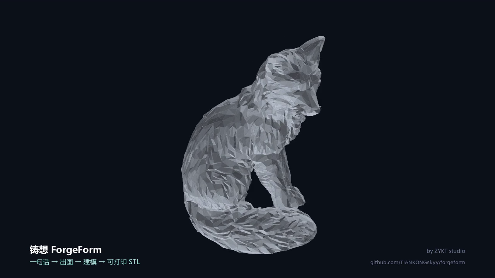
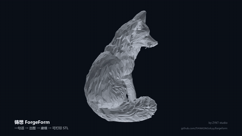

# 铸想 ForgeForm

输入一句话，得到可打印的 STL。

本地跑完整链路：LLM 解析需求 → 出图 → 图生 3D → 修水密 → 导出毫米级 STL。不调云端 API。

**官网 / 在线试用**：[zykt.space/foundry](https://zykt.space/foundry) · 作者：[ZYKT studio](https://zykt.space)

**仓库**：[GitHub](https://github.com/TIANKONGskyy/forgeform) · [Gitee 镜像](https://gitee.com/zyktspace/forgeform)（国内访问更快）



<p align="center">
  
</p>


<br clear="right" />

## 能做什么

| 阶段 | 做什么 | 后端 |
|---|---|---|
| 对话 | 需求解析、参数补齐、多轮修改 | 本地 LLM（OpenAI 兼容端点 / Ollama） |
| 出图 | 文生图，1–4 张候选，参考图 i2i、局部重绘 | ComfyUI 或 diffusers 直连 |
| 建模 | 单图生 3D；**多视图（四张真实照片）生 3D** | ComfyUI（Hunyuan3D 2.1 / V2 2mv）或 hy3dgen 直连 |
| 贴图 | PBR 上色（albedo + metallicRoughness），`tools/paint_asset.py` | ComfyUI（Hunyuan3D Paint PBR 2.1） |
| 骨骼 | 自动绑定（模板骨架 / RigAnything） | Blender headless + 可选 RigAnything |
| 动作 | BVH mocap 重定向（走 / 挥 / 鞠 / 待机） | Blender headless（纯 CPU） |
| 精修 | 粗网格 + 参考图 → 更细网格（可选档） | Direct3D-V3 |
| 导出 | GLB → STL：小壳过滤、减面、补洞、水密、毫米、居中贴地 | trimesh / pymeshlab / pymeshfix |
| 打印 | 局域网发现拓竹打印机并直发 | bambu-cli（可选） |
| 管理 | 对话组、项目归档、模型库、显存/温度监控 | 内置 |

逆向入口：上传视频抽帧建模、上传 GLB 直接转 STL。

**能力工作台（v3.8.3）**：界面里「🛠 能力工作台」折叠面板可直接跑骨骼 / 贴图 / 精修 / 多视图 / 动画，
每页都有 3D 预览、下载、耗时日志；对外接口名固定为 `/cap_rig` `/cap_paint` `/cap_refine`
`/cap_multiview` `/cap_motion`（和命令行走同一套产品入口）。

**实测状态（2026-11-28，V100）**：出图 z_image 21 s / klein 28 s / flux 61 s / qwen 464 s；3D 2mini 69 s / 2.1@512 676 s；骨骼模板 53 s。
贴图 PBR、精修、多视图、动画依赖额外扩展与权重，见 `docs/E2E-FULL-REPORT-2026-11-28.md`。

**一键开始**：双击 `一键开始.ps1`（先体检再启动）；只想要环境诊断就跑 `python tools/doctor.py`。
出问题跑 `python tools/report.py` 生成**已脱敏**诊断包，直接贴 issue。

**成品总览**：`python tools/collect_gallery.py` 把所有生成路线的代表模型收进一个文件夹
（默认 `D:\铸想模型总览`），带二进制体检表（面数/水密/贴图/关节/动画）与三视角预览图。

**多视图怎么用**（v3.8.0 新增，实测比单图更准）：

```python
from backend.pipeline import Pipeline
pipe = Pipeline("config.json")
r = pipe.generate_3d_multiview({
    "front": "正面.jpg", "back": "背面.jpg",
    "left":  "左侧.jpg", "right": "右侧.jpg",
}, quality_name="高质量")
```

拍照只有一条硬要求：**四张同仰角、方位严格 90°**。物体在画布里多大无所谓
（管线自己按 bbox 归一化，实测尺度差 2.2 倍反而分数更高）。
**不要预先抠图**——送透明底/黑底进去会被再抠一遍，实测 0.4872 → 0.3112。

## 实测（Tesla V100 32G，单卡）

| 动作 | 耗时 |
|---|---|
| 出图 1024²，Qwen-Image-2.1，20 步 | ≈ 56 s |
| 出图 1024²，30 步（含中→英翻译） | ≈ 140–170 s |
| 建模 Hunyuan3D 2.1，256 octree | ≈ 160 s |
| 建模 Hunyuan3D 2.1，512 octree | ≈ 8–10 min |
| **建模 多视图 2mv@512（四张真实照片）** | **≈ 84 s，49 万面，水密** |
| 建模 Hunyuan3D 2mini 直连，256 octree | 加载 42 s + 推理 13 s |
| 贴图 Paint PBR 2.1（120k 面，2048² atlas） | ≈ 216 s，峰值 13.7 GB |
| 精修 Direct3D-V3，512 档 4 步 | ≈ 33 s，峰值 5.8 GiB |
| 绑定 模板骨架（任意水密网格） | 8–68 s，零显存 |
| 绑定 RigAnything（角色，52 骨含手指） | ≈ 52 s，峰值 4.7 GB |
| 动作 BVH 重定向（24 帧循环） | ≈ 3 s，纯 CPU |
| 导出 STL（20 万面 → 8 万面） | ≈ 3–6 s |


四个作品的真跑记录（每件含耗时、面数、水密、STL 四视角渲染）：
`docs/showcase/`

## 快速开始

### 方式一：解压后双击

1. 下载 [`forgeform-v3.8.0.zip`](https://github.com/TIANKONGskyy/forgeform/releases/latest) 并解压
2. 双击 **`启动.bat`**

它会依次做：检查 Python → 建 `.venv` 并装依赖（3–5 分钟，只一次）→ 首次运行跑配置向导
（探硬件、选方案、装模型）在独立的 **铸想桌面窗口**中完成。首次启动会准备桌面窗口所需的 Python 依赖，Windows 需要 WebView2 运行时。

之后每次双击直接进界面（约 10 秒）。窗口就是服务端，关掉窗口即停止。

首次运行向导：

> 硬件：Tesla V100 32G（可用 30） · 内存 128 GB · 磁盘剩 166 GB
> 已有：ComfyUI(含3D)、本地 diffusers 模型 2 个、hy3dgen、对话服务
>
>  ★ [1] 复用现有 ComfyUI（零下载）        0.0 GB · auto
>    [2] 最小可用（SD1.5 + 3D 2mini）       8.2 GB · direct
>    [3] 标准（Z-Image Turbo + 3D 2mini）  30.6 GB · auto

### 方式二：命令行

适合想自己控制环境的人。四步：

| 步骤 | 做什么 |
|---|---|
| 1 | 把仓库 clone 或下载解压到本地 |
| 2 | 装运行依赖（`requirements.txt`，约 2–3 GB） |
| 3 | 跑配置向导，它会探硬件、列方案、下模型 |
| 4 | 启动，浏览器打开 `127.0.0.1:7860` |

依赖和模型都不在仓库里 —— 仓库只有源码，模型要单独下（见下面「模型」一节）。

`tools/setup.py` 会先识别显存、内存、磁盘，以及机器上已有的 ComfyUI / Ollama / llama.cpp /
vLLM / 本地 diffusers 模型，然后给出可选方案：

> 硬件：Tesla V100 32G（可用 30） · 内存 128 GB · 磁盘剩 166 GB
> 已有：ComfyUI(含3D)、本地 diffusers 模型 2 个、hy3dgen、对话服务
>
>  ★ [1] 复用现有 ComfyUI（零下载）        0.0 GB · auto
>    [2] 最小可用（SD1.5 + 3D 2mini）       8.2 GB · direct
>    [3] 标准（Z-Image Turbo + 3D 2mini）  30.6 GB · auto

也可以 `--dry-run`（只看方案）、`--custom`（自己选模型）、`--profile <名字> --yes`（直接装）。

装完自检：

`tools/doctor.py` 会检查环境缺什么、该装什么，出问题时先跑它。

## 硬件要求

- Windows 10/11
- NVIDIA GPU，**6 GB 显存**起步（2mini 256oct 峰值 3.9 GB，512oct 5.35 GB）
- 内存 16 GB 也能跑通（低内存机器自动启用逐层搬显存 + fp16 构建，见 docs/MODEL-BENCH.md）
- 内存 32 GB 建议（直连 3D 时模型自身占 10.8 GB）
- Python 3.11–3.13
- 一个本地 LLM 端点（可选，没有则降级成规则模式）

各显存档位能跑什么、实测占用多少：`docs/HARDWARE.md`

## 模型

所有模型按 `config.json` 里写的**文件名**从 ComfyUI 目录找，或用 `path` 指本地 diffusers 目录。
每个权重下哪个、放哪、多大：`docs/MODELS.md`。

换模型 = 改一个 YAML（`plugins/image/*.yaml`），不改代码：`docs/PLUGINS.md`。

## 后端

三种模式，改 `config.json → backend.mode`：

| mode | 行为 |
|---|---|
| `comfyui` | 只用 ComfyUI（默认） |
| `direct` | 只用 diffusers / hy3dgen，不依赖 ComfyUI |
| `auto` | 启动时探测本机有什么，按阶段自动路由 |

细节与实测数据：`docs/BACKENDS.md`

## 文档

| 文件 | 内容 |
|---|---|
| `docs/HARDWARE.md` | 实测显存/内存占用、各档配置对照 |
| `docs/MODELS.md` | 模型下载地址、放哪、多大 |
| `docs/CONFIG.md` | 配置项与按显存分档的方案 |
| `docs/PLUGINS.md` | 模型插件（YAML） |
| `docs/BACKENDS.md` | 三种后端与实测对比 |
| `docs/MODEL-BENCH.md` | 各模型在同一提示词下的实测数据 |
| `docs/EXTENSIBILITY.md` | 扩展点：换模型、给 agent 用、加 stage |
| `docs/ARCHITECTURE.md` | 模块职责与核心机制 |
| `docs/DECISIONS.md` | D1–D10 设计决策记录 |
| [`docs/RESEARCH-MASTER-2026-11-26.md`](docs/RESEARCH-MASTER-2026-11-26.md) | 六方向实测总表（贴图 / 骨骼 / 运动 / 精度 / 多视图 / 低显存） |
| [`docs/RESEARCH-BRIEF-6DIRECTIONS-2026-11-26.md`](docs/RESEARCH-BRIEF-6DIRECTIONS-2026-11-26.md) | 本机环境事实与踩坑清单（V100 没有 OpenGL、SDPA 只有 EFFICIENT 等） |
| [`docs/MERGE-CODEX-2026-11-26.md`](docs/MERGE-CODEX-2026-11-26.md) | v3.8.0 合并了什么、拒了什么、为什么 |
| `skills/forgeform/SKILL.md` | 给 agent 用的技能文件 |
| `CONTRIBUTING.md` / `SECURITY.md` | 贡献约定 / 安全说明 |

## 测试

| 命令 | 内容 |
|---|---|
| `pytest` | 233 个用例，不需要 GPU |
| `verify.py` | 152 条结构性断言 |
| `healthcheck.py` | 12 项全链路自检（含上面两项） |
| `e2e_full.py` | 真跑一遍全流程，约 5 分钟 |

`healthcheck.py` 是最省事的入口 —— 它会检查插件、配置引用、入口文件、文档、
推荐逻辑、后端接口、更新器，最后再跑 pytest 和 verify。

## 许可证

AGPL-3.0。水密修复链入了 `pymeshselab`（GPL-3.0）和 `pymeshfix`（AGPL-3.0），copyleft 会传染。
用它产出的模型和打印件归使用者，不受 AGPL 约束。

第三方组件清单：[NOTICE](NOTICE)

## 三个新入口（v3.5.0）

**本机能力 API** —— 把出图/建模/STL/对话开给别的程序调：

```bash
PYTHONPATH= python tools/api_key.py issue --label 我   # 签发一把 ff_ key
PYTHONPATH= python tools/api_server.py                # 127.0.0.1:7863
# 文档 http://127.0.0.1:7863/docs   规范 docs/API-SPEC.md
```

**云端 API** —— 扩写/出图/建模可以接云端（本地没装权重也能用），key 用
Windows DPAPI 加密只落本机：

```
config.json → cloud.enhancer / cloud.image / cloud.mesh
Studio 的 /api/cloud 读写，或用 GET /api/cloud 看缺什么
```

**运行信息留存** —— GPU/内存/CPU/磁盘每 3 分钟一行，`logs/metrics-*.jsonl`
滚动 14 天；`outputs/` 中间产物 30 天可清，`projects/` 作品永不清理：

```bash
PYTHONPATH= python tools/calibrate.py --summary   # 看本机实测与占用
```

**API 密钥安全** —— 明文只在生成时显示一次，库里只存 sha256，且整个库用本机
DPAPI 加密（拷到别的机器解不开）；每把有独立 id、可选有效期（默认 90 天）、
可撤销可删除，每次调用写 `logs/api-*.jsonl` 审计（只记 key id 与 IP，不记 token）。
界面在「模型与配置 → API 密钥」，命令行 `tools/api_key.py`。

## 装不上？先跑自检

```bash
PYTHONPATH= python tools/doctor.py            # 环境 8 项 + 网络 3 类，逐项给修法
PYTHONPATH= python tools/doctor.py --refresh  # 忽略缓存重测网络
```

它当场测 PyPI / GitHub / HF，各挑一个**实测最快**的源（不写死阿里云/清华），
并把缓存写进 `logs/net-cache.json`（1 小时）。35 条常见问题的逐条解法见
[docs/NETWORK-AND-ENV.md](docs/NETWORK-AND-ENV.md)。

## 下载后怎么最快用上

双击 `启动.bat` → Studio 打开 → 顶部「一键开始」那张卡会显示这台机器
**现在能直接用什么**（对话 / 出图 / 建模 三条链分别标 ✓ 或 ✗），
再点「开始用」，它自己挑最快路径并写好配置：

1. **复用已有 ComfyUI / hy3dgen / diffusers** —— 0 下载（装过 AI 工具的人走这条）
2. **云端 API** —— 0 下载（填一次 key）
3. **下载最小方案** —— 约 10 GB，界面在下载期间已经能用
4. **只开界面** —— 什么都跑不动时也不白屏

出厂配置的默认模型可能指向没下载的权重，`backend/firstrun.py` 会自动把默认
换成这台机器上**真有文件**的那个（例如 2.1 → 2mini），不用人排查。
