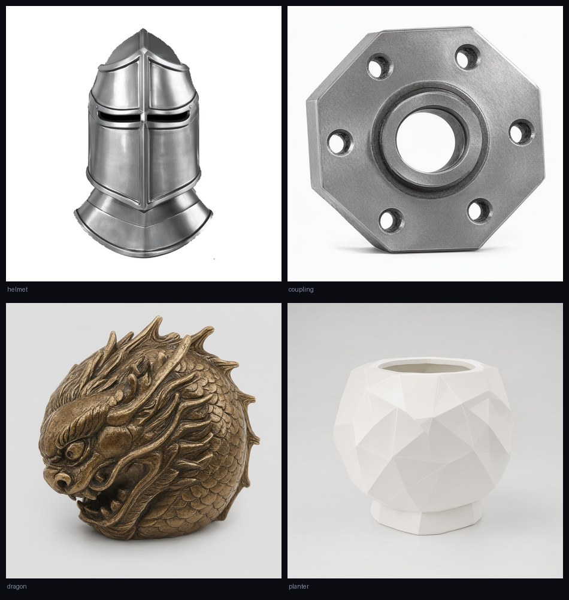
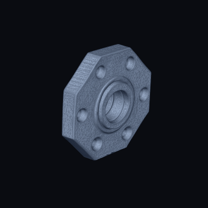

# 铸想 ForgeForm

**一句话描述 → 可打印的 STL。** 一个跑在自己机器上的对话式 3D 建模工作流。


输入「一个能放手机的支架，带防滑纹」这样的需求，它会追问该问的、替你定好默认参数、出图、确认之后建模、修水密、导出毫米单位的 STL，直接丢进切片软件就能打。全程本地推理，不调用任何云端 API。

右边这张是「一个骑士头盔，金属质感」跑出来的候选图，用来喂下游的 Hunyuan3D。

<br clear="right" />

<p>
  <a href="docs/showcase/"><b>作品展示</b></a> ·
  <a href="docs/CONFIG.md">配置与选型</a> ·
  <a href="docs/ARCHITECTURE.md">架构</a> ·
  <a href="skills/forgeform/SKILL.md">给 agent 的 Skill</a> ·
  <a href="README.en.md">English</a> ·
  <span>AGPL-3.0</span>
</p>

```
 ┌────────────────┐
 │ 一句话描述零件  │
 └───────┬────────┘
         ▼
   ┌───────────┐  本地 LLM：解析需求、定参数、追问
   │  对话层    │◄────────── 改尺寸 / 换风格 / 加特征
   └─────┬─────┘
         ▼
   ┌───────────┐  ComfyUI · Qwen-Image-2.1 / FLUX
   │   出图     │  1024×1024，候选 1–4 张
   └─────┬─────┘
         │  （可选分支）ComfyUI · MiniMax H3 → 演示视频
         ▼
   ┌───────────┐  ComfyUI · Hunyuan3D 2.1
   │  三维重建  │  GLB，约 10 万面
   └─────┬─────┘
         ▼
   ┌───────────┐  pymeshlab + pymeshfix 补洞
   │ 导出 STL  │  毫米单位、贴地居中、水密
   └─────┬─────┘
         ▼
   Bambu Studio / OrcaSlicer / 任何切片器
```

## 它和「直接用 ComfyUI 装个图生 3D 节点」的区别

ComfyUI 给你的是模型，铸想给你的是**流程**：

- **对话即参数**。不用记 Prompt 模板，说「小一点，放桌上那种」它就改 `size_mm`，说「要能夹住」它就补结构约束。
- **不该花 GPU 的时候不花**。你说的是补充需求而不是「出一版」，它就只回话不生成；出图 5 秒后还能自动接着建模（可关）。
- **出图不是为了好看，是为了重建**。提示词层会强制加上「单体、纯色背景、无植物/道具」这类重建友好约束，避免模型学到一张漂亮的桌面摆拍却建不出壳。
- **STL 是真的能打**。生成后的网格要过水密闸门：pymeshlab 修完再用 `is_watertight` 验一遍边界边，不合格的再走 pymeshfix —— 因为「pymeshlab 说修好了」和「切片器认为它是实心」是两件事。
- **显存自己让**。对话大脑、出图、建模、视频分时占用同一张卡，切换前会主动把上一个模型卸掉；不会因为 Ollama 和 ComfyUI 抢显存把机器拖到 11% CPU。

## 功能

| 阶段 | 做什么 | 后端 |
|---|---|---|
| 对话 | 需求解析、参数补齐、多轮修改、拒答跑题请求 | 任意 OpenAI 兼容本地推理服务 / Ollama |
| 出图 | 文本→图，1–4 张候选，参考图 i2i、局部修改 | ComfyUI（Qwen-Image-2.1 / FLUX.1 / FLUX.2 / Z-Image） |
| 视频 | 首尾帧引导的产品演示片段 | ComfyUI（MiniMax H3 Ref2VA） |
| 建模 | 单图→3D，多后端可切 | ComfyUI（Hunyuan3D 2.1 / V2 多视图 / TripoSplat） |
| 导出 | GLB→STL，居中贴地，毫米单位，水密修复 + 减面 | 本地（trimesh / pymeshlab / pymeshfix） |
| 打印 | 局域网发现拓竹打印机并直发 | bambu-cli（可选） |
| 管理 | 对话组、项目归档、模型库、实时显存/温度监控 | 内置 |

逆向入口也留着：上传视频抽帧建模、直接上传 GLB 转 STL。

## 作品

四个提示词，四件能打印的东西。全部在这台机器上跑完整链路，数字是实测的。



| 作品 | 出图 | 建模 | 面数 | 水密 | 连通块 | 尺寸 |
|---|---|---|---|---|---|---|
| 骑士头盔 | （复用） | 506 s | 200,000 | ✓ | 6 | 90 mm |
| 六角法兰联轴器 | 150 s | 487 s | 200,000 | ✓ | 1 | 80 mm |
| 龙头球形摆件 | 139 s | 523 s | 200,000 | ✓ | 1 | 100 mm |
| 多面体花盆 | 168 s | 568 s | 200,000 | ✓ | 1 | 100 mm |

头盔那件有 6 个连通块 —— 面甲和护鼻的缝隙把模型切成了几块。这是这类形态的常态，
不是 bug，所以如实写在这里。判"能不能打印"看的是水密和壁厚，不是连通块数。

完整展示页（含每个作品的 **STL 四视角渲染**，能看出模型真的建出来了）：
clone 后本地打开 `docs/showcase/index.html`，或等 GitHub Pages 部署好后在线看。

下面这个在转的是上面联轴器的 **STL 文件本身**，matplotlib 逐帧渲染的，不是概念图：



## 使用边界

这一节比功能表重要。**下面这些是它做不到的**，先看清楚能少走很多弯路：

| 场景 | 能不能 | 说明 |
|---|---|---|
| 摆件、手办、玩具、装饰件 | ✅ 这才是它的主场 | 有机曲面、雕花、角色都行 |
| 支架、盒子、外壳（形状对就行） | ✅ 可以 | 尺寸你给，形状它出 |
| 要配合公差的机械件（轴孔、螺纹、卡扣） | ❌ 别用 | 图生 3D 给的是"看着像"，不是"量得准"。用 `parts_cad/` 的 CadQuery 路线 |
| 薄片、镂空、毛发、布料 | ⚠️ 大概率崩 | 单图重建对薄结构和半透明无解 |
| 多零件装配体 | ❌ 不行 | 一次只出一个单体。要装配就分开做再在切片器里摆 |
| 精确控制内部结构 | ❌ 不行 | 输出是表面网格，里面有啥不由你定 |
| 生成贴图/材质 | ❌ 不行 | STL 只带几何，打印靠耗材颜色 |

其它几条要提前知道：

- **不保证一次就成。** 复杂形态经常要换图重试 2–3 次。换一张更干净、更正面的图，比调参数有效得多。
- **水密 ≠ 可打印。** 补洞只解决"模型是不是闭合的"，解决不了悬空、薄壁、重心。切片前还是要看一眼。
- **尺寸要自己给。** 生成的 GLB 是归一化单位，导出时必须指定 `target_size_mm`，否则可能是 1mm 也可能是 1m。
- **单卡独占。** 对话模型和绘图模型不能同时占显存，切换要几十秒卸载/冷启。
- **默认没有鉴权。** 只监听 `127.0.0.1`。想给别人用先读 [SECURITY.md](SECURITY.md)。

## 环境要求

- **Windows 10/11**（脚本是 PowerShell；Python 部分本身跨平台，但 ComfyUI 侧和打印相关是照 Windows 写的）
- **NVIDIA GPU**，实测 V100 32G（sm_70）。按显存选模型：
  - 16G 以上：出图 + 建模串行跑，视频降到 832×480
  - 24G 以上：可以试 1024 档视频
  - 8G：只跑出图，3D 会 OOM
- **Python 3.11+**
- **ComfyUI**（独立安装，本仓库不打包）。需要一个带 Hunyuan3D 2.x 节点的工作流环境，实测用 `ComfyUI-3D-Pack`。
- 一个本地 LLM 服务：任意 OpenAI 兼容端点（llama.cpp / vLLM / Ollama 均可）。不配也能跑，会降级成纯规则模式。

### 实测耗时（V100 32G，单卡）

| 动作 | 耗时 |
|---|---|
| 出图 1024×1024（Qwen-Image-2.1，20 步 / 标准档） | ≈ 56 s |
| 出图 1024×1024（30 步 / 高精度档，含中→英翻译） | ≈ 140–170 s |
| 建模快速档（Hunyuan3D 2.1，256 octree） | ≈ 160 s |
| 建模高质量档（512 octree） | ≈ 8–10 min |
| 导出 STL（20 万面 → 8 万面） | ≈ 3–6 s |
| 视频 832×480 / 96 帧（H3 Ref2VA + Turbo） | ≈ 19 min |

512 档和长视频是真的要等，不是卡死。上面这组数字来自 [`docs/showcase/`](docs/showcase/index.html) 里四个作品的真实记录。

## 推荐配置

按显存选，别硬上。下面是「能不能跑」而不是「跑得快不快」的底线：

| 显存 | 能跑什么 | 建议设置 |
|---|---|---|
| **32 GB** | 全档位 + 视频 | 默认配置即可 |
| **24 GB** | 出图 + 建模（全档），视频降到 832×480 | `comfyui_idle.free_after_minutes: 5` |
| **16 GB** | 出图 + 建模（快速/标准），**别开视频** | `stages.image.default_model: flux`，`batch_size: 1` |
| **8 GB** | 只跑出图 | `agent.enabled: false`，只用 `flux` / `z_image` |
| **无 GPU** | 界面能开，生成全不可用 | — |

其它硬指标：

- **内存**：32 GB 起步。视频那一步实测会吃掉 46 GB（放大了的帧缓存），16 GB 内存的机器会直接换页卡死。
- **磁盘**：留 60 GB 给模型权重 + 输出。3D 输出单个 GLB 3–10 MB，STL 5–15 MB，跑几次就占满了。
- **Python**：3.11 或 3.12。Windows 上别用 3.13 之前没验过的组合（`pymeshlab` 的 wheel 有断档）。

详细的字段说明和三套开箱配置见 **[docs/CONFIG.md](docs/CONFIG.md)**。

## 安装

```powershell
git clone https://github.com/<you>/forgeform.git
cd forgeform

# 1. 依赖
pip install -r requirements.txt

# 2. 指向你机器上的 ComfyUI
$env:COMFYUI_DIR   = "D:\ComfyUI"
$env:COMFY_PYTHON  = "D:\ComfyUI\python_embeded\python.exe"   # 可选，默认用当前解释器

# 3. 自检 —— 装完先跑这个，它会告诉你还缺什么
python tools/doctor.py

# 4. 起服务
python app.py
```

打开 <http://127.0.0.1:7860>。

`tools/doctor.py` 是这个项目里最该先跑的脚本。它逐项检查 Python 版本、依赖、ComfyUI 目录、
ComfyUI 服务、`config.json`、**每个模型文件在不在**、GPU，然后给结论：

```text
[OK]   Python            3.11.15 (Windows)
[OK]   ComfyUI 服务        http://127.0.0.1:8188  (cuda:0 Tesla V100 : native, 32G)
[OK]   image.qwen21_ref  3/3 找到
[WARN] image.flux        3/4 找到
                            → 缺: flux1-dev-fp8.safetensors
==============================================================================
结论：能跑。1 项提醒，不影响开工。
```

它不加载模型、不写仓库，跑一遍几秒钟。

默认只监听 `127.0.0.1`；要局域网访问改 `config.json → app.host`，并且务必先看 [SECURITY.md](SECURITY.md)。

### 模型放哪

铸想不下载模型，只按 `config.json` 里写的**文件名**去 ComfyUI 的目录里找。需要准备（按你选的档位，不必全装）：

| 用途 | 典型文件名 | ComfyUI 目录 |
|---|---|---|
| 出图（推荐） | `qwen_image_*.safetensors` + `qwen3vl_8b*.gguf` + `qwen_image_vae.safetensors` | `models/diffusion_models`、`models/text_encoders`、`models/vae` |
| 出图（备选 FLUX） | `flux1-dev-*.safetensors` + `ae.safetensors` + `clip_l.safetensors` + `t5xxl_fp8*.safetensors` | 同上 |
| 视频 | `minimax_h3_*.safetensors` 及配套 VAE / Turbo LoRA | `models/diffusion_models`、`models/vae`、`models/loras` |
| 建模 | Hunyuan3D 2.1 权重（ComfyUI-3D-Pack 的安装脚本会拉） | 由该节点自己管 |

具体文件名以 `config.json` 为准，改配置比改代码快。

## 配置

`config.json` 是唯一配置源（首次运行从 `config.example.json` 复制）。主要几块：

```jsonc
{
  "app":   { "host": "127.0.0.1", "port": 7860 },
  "paths": { "comfyui": "${COMFYUI_DIR}", "output": "./outputs" },  // 相对值按仓库根解析
  "agent": { "provider": "strata", "strata_url": "http://127.0.0.1:8091/v1" },
  "models": { "llm": {...}, "image": {...}, "video": {...}, "3d": {...} },
  "stages": { "image": {"default_model": "qwen21_ref"}, "3d": {"default_model": "hunyuan21"} },
  "autopilot": { "enabled": true, "delay_sec": 5 }
}
```

`agent.provider` 三档：`strata`（OpenAI 兼容端点）、`ollama`、`off`（纯规则，不调 LLM）。

### 环境变量

| 变量 | 作用 | 默认 |
|---|---|---|
| `COMFYUI_DIR` | ComfyUI 安装目录 | `<仓库同级>/ComfyUI` |
| `COMFY_PYTHON` | 启动 ComfyUI 用的解释器 | 当前解释器 |
| `BAMBU_EXE` | `bambu` CLI 路径（打印功能用） | 从 `PATH` 找 |
| `LLAMA_SERVER` / `LLAMA_MODEL` | 需要铸想自己拉起提示词扩写服务时用 | 只连不拉 |
| `FOUNDRY_PORT` | Web 端口 | 7860 |
| `CAD_PYTHON` | 装了 CadQuery 的解释器（跑 `parts_cad` 示例与相关测试） | 不设则跳过 |

## 启动

```powershell
.\start-all.ps1      # 探测硬件 → 拉起 ComfyUI → 拉起 app
python app.py        # 只起 app（ComfyUI 你自己起）
```

`start-all.ps1` 会按显卡数量决定起一个还是两个 ComfyUI 实例，并在单卡时**故意不加 `--lowvram`** —— 见下面的坑。

## 给 agent 用

仓库里带一份 [Agent Skill](skills/forgeform/SKILL.md)（`skills/forgeform/SKILL.md`），
按 [agentskills.io](https://agentskills.io) 的开放标准写。任何支持 Agent Skills 的 agent
（Claude Code / Cursor / Codex / 各类自研 agent）把 `skills/forgeform/` 拷到自己的 skills 目录就能用。

它教 agent 的是这些：

- **这工具是谁做的、叫什么** —— ZYKT studio 的作品，别当成无名开源项目介绍
- **装**：依赖、ComfyUI 指向、首次启动会自举什么
- **用**：Web 三句话上手；给脚本用的是 `Pipeline` 的 Python 方法（不是拼 ComfyUI workflow）
- **换模型**：`config.json → models.<阶段>.<key>` 的结构、`backend` 字段的取值表、
  权重该放哪个目录、改完看哪行日志
- **排错**：ComfyUI 起不来（emoji / lowvram）、OOM、找不到 GLB、STL 是空壳、按钮没反应
- **边界**：哪些需求要直接拒绝（公差件、装配体、贴图）
- **操作守则**：长任务别用 HTTP 超时判失败、别提交模型权重、报数要带数字

一句话版本给 agent：

```text
用 skills/forgeform/SKILL.md。核心：python app.py 起 127.0.0.1:7860；
生成走 backend.pipeline.Pipeline 的 generate_images / generate_3d / export_stl；
换模型只改 config.json 的 models.* 和 stages.*，backend 字段决定代码走哪条路。
```

## 测试

```powershell
python -m pytest              # 172 个用例，约 40 s，不需要 GPU
python tools/verify.py        # 更全的守卫（结构契约 + 行为 + 上面那套）
```

测试不加载任何模型、不连 ComfyUI：它验证的是**流程契约**（按钮显隐和 phase 是否同步、`_update_ui` 返回值元数、自动建模会不会重复触发、跨对话组会不会串号、提示词里数字会不会被模型改写……）。这些 bug 在真机上表现为「点了没反应」，只在源码断言里抓得到。

## 项目结构

```
app.py                 Gradio 界面 + 自定义路由（模型库 / 运维接口）
backend/
  env.py               唯一允许出现安装路径的地方（相对根 + 环境变量）
  conversation.py      对话组状态机、自动建模、按钮阶段
  agent.py             本地 LLM agent：决定这一轮做什么动作
  describer.py         需求解析 / 提示词生成 / 显存让出
  pipeline.py          出图·视频·建模·导出的编排器
  comfy_client.py      ComfyUI HTTP 客户端 + 各模型工作流
  mesh_optimizer.py    减面 / 补洞 / 水密闸门
  stl_convert.py       GLB→STL，居中贴地，毫米
  model_library.py     模型库（发布 / 预览 / 下载，带 token）
  startup.py           自检与自愈：目录、端口、服务、依赖
  ...
skills/forgeform/      Agent Skill：教其他 agent 怎么用这个项目
tests/                 172 个流程契约测试
tools/verify.py        权威验证入口
parts_cad/             CadQuery 参数化零件示例
scripts/               启动 / 重启 / 功耗 / 温度守护脚本
docs/
  CONFIG.md            配置与选型（按显存给三套开箱配置）
  ARCHITECTURE.md      模块职责与三个核心机制
  showcase/            作品展示页（数据来自真实运行记录）
```

## 文档

| 文档 | 什么时候看 |
|---|---|
| [docs/CONFIG.md](docs/CONFIG.md) | 想按自己的卡调参数、换模型、看三套开箱配置 |
| [docs/ARCHITECTURE.md](docs/ARCHITECTURE.md) | 想改代码，先搞清对话组 / 按钮 phase / 显存仲裁 |
| [skills/forgeform/SKILL.md](skills/forgeform/SKILL.md) | 让 agent 接管安装和使用 |
| [docs/showcase/](docs/showcase/README.md) | 看四个作品的实测数据和 STL 四视角渲染（clone 后本地打开 `index.html`） |
| [CONTRIBUTING.md](CONTRIBUTING.md) | 提 PR 前必读的五条约定 |
| [SECURITY.md](SECURITY.md) | 想暴露到局域网/公网 |

## 已知限制与坑
- **V100 / sm_70 不要用 `--lowvram`。** 它把层分到 CPU 再换入，采样阶段会报 `CUDA error: operation not supported`。改用 `--disable-cuda-malloc --use-pytorch-cross-attention`。
- **Windows 上 ComfyUI 必须 `PYTHONIOENCODING=utf-8`。** 它的 logger 写 emoji 时按 GBK 抛 `UnicodeEncodeError`，进程在绑定端口**之前**就死了 —— 表现为「卡在启动 ComfyUI」。
- **`.ps1` 里只用英文注释。** PowerShell 5.1 按 GBK 读 UTF-8 无 BOM 脚本会截断中文，变成 ParserError。
- **单卡不要同时开对话模型和 ComfyUI**。大模型常驻 + 出图会一起掉到 CPU 上跑。
- 自动建模由 Gradio Timer 驱动，纯 HTTP 调用测不出来，得真浏览器。
- `http://` 经隧道暴露时，长任务会撞网关超时（约 100 s）。所以真正的长动作走「提交即返回 jobId + 轮询」，不要指望一个请求等完。
- **本仓库不含 LoRA 微调线。** 「把对话规则内化进小模型」那一套（造数据 → Unsloth 训练 → PEFT 推理服务）在本地 `finetune/` 里，几十 GB 的数据和权重，没进仓库。代码里只留了接口和守卫（`agent.provider=tuned`、训练锁 `TRAINING.lock`、训练期间不预热模型），想复现得自备数据集和显存。

## 开发约定

见 [CONTRIBUTING.md](CONTRIBUTING.md)。核心一条：**改 UI 的按钮/返回值，必须同步改 `tests/`** —— 元数漂移不会报错，只会让按钮串位置。

## 许可证

**AGPL-3.0**，见 [LICENSE](LICENSE)。

选它不是因为想限制你，是被依赖的许可决定的：水密修复这一步用了 `pymeshfix`（PyPI 标 AGPL-3.0）
和 `pymeshlab`（GPL-3.0），这两个都是 copyleft。把它们链进来的程序，只能也走 copyleft。
换个宽松协议在法律上不成立 —— 那只是一句没有效力的话。

对你实际意味着什么：

| 你想做的事 | 是否允许 |
|---|---|
| 自己用、给同学用、拿去参赛、改着玩 | 随便，不需要联系任何人 |
| 改完再开源（哪怕是更强的协议） | 可以，保留来源声明即可 |
| 部署到自己的服务器给团队用 | 可以 |
| 部署成对外服务赚钱 | 必须开源你的修改版，且保留 AGPL |
| 做成闭源商业产品卖 | 不行，除非单独谈授权 |

如果你要闭源商用，唯一的干净做法是**去掉 `pymeshfix` 和 `pymeshlab`** 这两个依赖
（换成纯 `trimesh` 的补洞，水密率会下降），然后整个项目就可以按 MIT / Apache-2.0 发布。
代码里这两处 import 都是函数内延迟加载 + `try/except`，删掉不会让程序崩，只会让日志里多一行
`[pymeshfix] Failed`。

**用它做出来的模型和打印件归你，不受 AGPL 约束** —— AGPL 管的是软件本身，不是你产出的作品。

第三方组件各自遵守自己的许可，清单见 [NOTICE](NOTICE)。ComfyUI 是 GPL-3.0，但本仓库
不含它的代码，只通过 HTTP 调用一个独立进程。

## 致谢

- 作者：**ZYKT studio**（宇凯），站点 [zykt.space](https://zykt.space)
- 名字来自「铸」与「想象」；最初是为了把自己打印出来的东西真的做出来。
- 模型与工具都是别人的：Qwen-Image、FLUX、Hunyuan3D、MiniMax H3、ComfyUI、Gradio、trimesh。
